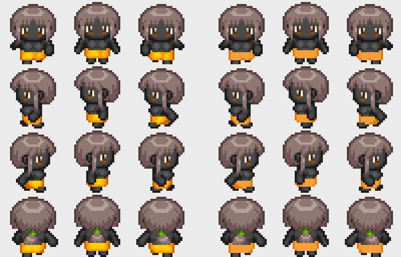

# Herramientas del campus

Scripts de Node (sin dependencias del monorepo de WorkAdventure) para trabajar con los **avatares**. Contexto: [`../AVATARES.md`](../AVATARES.md).

```bash
cd racks/tools
npm install          # solo instala pngjs
npm test             # 9 tests, incluidos los PNG reales de WorkAdventure
```

## `avatar-check.mjs`: ¿sirve este PNG como avatar?

```bash
node avatar-check.mjs mi-avatar.png                 # personaje completo (woka)
node avatar-check.mjs --layer=hat gorra-racks.png   # una capa: body|eyes|hair|clothes|hat|accessory
node avatar-check.mjs --layer=clothes diseños/*.png # varios a la vez
```

Sale con código **1** si algún fichero tiene errores, así que sirve tal cual para validar la entrega del reto "Diseña tu avatar" o en CI.

| Comprueba | Error o aviso |
|---|---|
| Mide **96×128** exactos | Error |
| Tiene fondo transparente | Error si no hay ningún píxel transparente; aviso si hay poco |
| Los **12 fotogramas** tienen contenido (personaje completo o cuerpo) | Error |
| Fotogramas vacíos en una capa | Aviso. **Excepciones:** los ojos de espaldas y las capas "ninguno" |
| Los 3 pasos de cada dirección son del mismo tamaño aproximado | Aviso (detecta personajes "que saltan") |
| Píxeles semitransparentes (reescalado con suavizado) | Aviso |
| Peso de más de 100 KB · datos sobrantes tras el final del PNG | Aviso |

**Probado contra los 300 personajes y las 277 capas de este repo.** Todos pasan salvo `customisation/character_color/_ȵ.png`, un fichero basura que no está en el catálogo. Por el camino aprendimos dos cosas que la herramienta ya tiene en cuenta:

- `character_hairs0` y `character_hats1` están **vacíos a propósito**: son la opción "sin pelo" y "sin sombrero".
- **4 PNG oficiales** llevan bytes sobrantes al final. El navegador lo tolera; la herramienta avisa y los lee igual.

## `avatar-recolor.mjs`: una plantilla, todas las variantes

```bash
node avatar-recolor.mjs sudadera-plantilla.png sudadera-racks.png "#c0392b=#f5911a"
node avatar-recolor.mjs gorra.png gorra-alumno.png "#c0392b=#1e88e5" "#2c3e50=#111111" --tolerance=30
```

- **Qué cambia:** cada píxel cuyo **tono** está cerca del color origen pasa al tono del destino, **conservando su luz relativa**. Por eso se mantienen las sombras y los pliegues.
- **Qué no toca:** los grises, es decir, los contornos y los blancos.
- **Para qué sirve:** es el "camino A" de `AVATARES.md`. Diseño hace **una** sudadera y salen una por plan y una con los colores de marca de cada alumno.



*Izquierda: personaje compuesto por capas con la ropa original. Derecha: la misma ropa recoloreada al naranja Racks. Las 4 filas son las 4 direcciones y las 3 columnas, los pasos.*

## `avatar-lib.mjs`

La lógica pura (`checkAvatar`, `recolor`, `composite`, `trimAfterIend`), sin E/S. La puede importar el futuro generador de la academia (`AVATARES.md` §4) en lugar de reescribirla.
